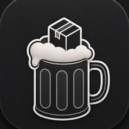
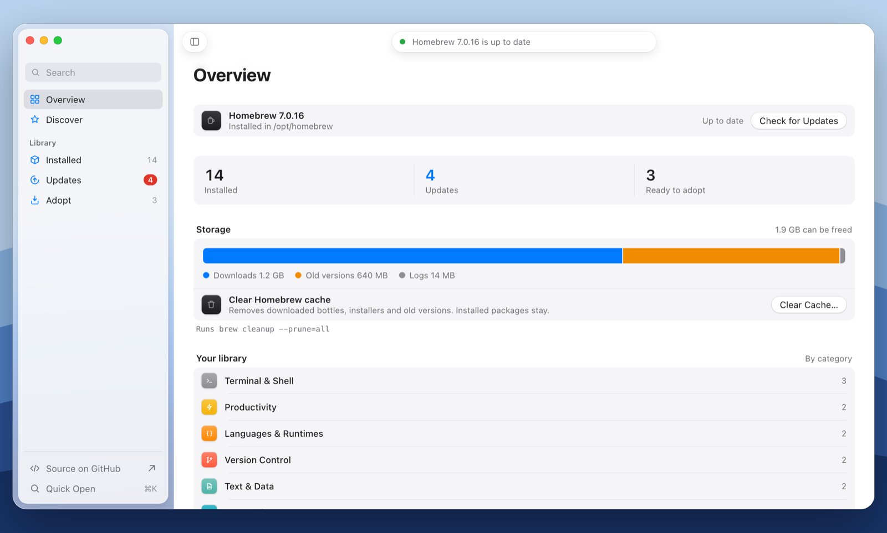
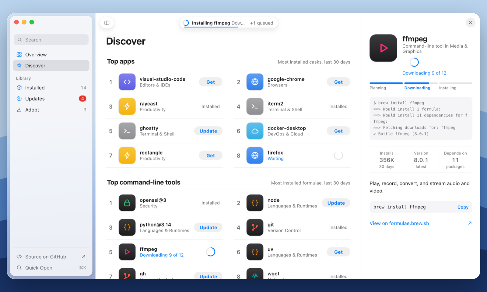
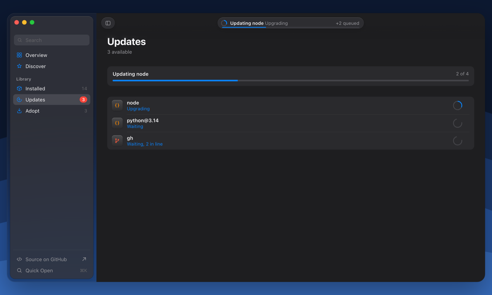
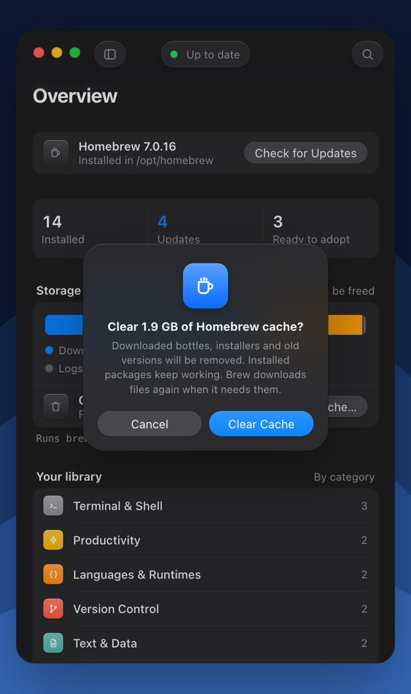

<p align="center"></p>

# brew·store

**A modern, native macOS app for [Homebrew](https://brew.sh) — search, install, and manage your packages without ever touching the terminal.** Fast, keyboard-friendly, and designed to feel like part of macOS.

[](LICENSE)

> ⚠️ brew·store runs real `brew` commands on your Mac. Installing, updating, and uninstalling actually change your system.

## What is it?

Homebrew is the package manager most Mac developers use — but it's terminal-only. brew·store gives it a proper graphical home: a searchable storefront for all ~16,000 Homebrew formulae and casks, one-click install/uninstall with real progress, an overview of what you've got, cache cleanup, and update management — all in a polished native window.

## Screenshots







<p align="center"></p>

<sub>Rendered from the design mockup with sample packages.</sub>

## Features

- **Overview** — your Homebrew version and whether it's current, counts of installed packages, updates and apps ready to adopt, a storage bar of what `brew cleanup` can free with a one-click **Clear Cache…**, and your library by category.
- **Discover** — the most installed apps and command-line tools this month, ranked by Homebrew's real install analytics, with instant search across all ~16,000 formulae and casks.
- **Real progress** — installs, updates and cleanups show step progress in the row, in the toolbar's activity viewer and on the Dock icon. Jobs queue, so you can keep browsing.
- **Installed** — command-line tools and apps in separate lists, with filtering and multi-select uninstall.
- **Updates** — what's outdated, with **Update All** or one at a time; the Dock badge shows the count.
- **Adopt** — apps already in `/Applications` that Homebrew has a cask for, so updates can happen here.
- **Native look** — macOS 27 design with Liquid Glass controls and system light/dark, plus **⌘K** Quick Open and **⌘F** search.

## Install

**Requires:** macOS on Apple Silicon (M1 or newer) and [Homebrew](https://brew.sh) — if Homebrew is missing, the app offers to install it on first launch.

1. Download **`BrewStore_0.3.0_aarch64.dmg`** from the [latest release](https://github.com/nitishmalpotra/brew-store/releases/latest).
2. Open the DMG and drag **BrewStore** into **Applications**.
3. The app isn't notarized yet, so macOS blocks the first launch. Clear the download quarantine once:

   ```bash
   xattr -cr /Applications/BrewStore.app
   ```

   (Or open it, then go to **System Settings → Privacy & Security** and click **Open Anyway**.)
4. Launch **BrewStore** from Launchpad or Spotlight.

### Uninstall

Quit the app, then:

```bash
rm -rf /Applications/BrewStore.app ~/Library/Caches/com.nitishmalpotra.brewstore ~/Library/WebKit/com.nitishmalpotra.brewstore
```

Your Homebrew packages are untouched.

## Build from source

You need **Xcode Command Line Tools**, **Node.js 22.18+**, and **Rust**:

```bash
xcode-select --install
brew install node
curl --proto '=https' --tlsv1.2 -sSf https://sh.rustup.rs | sh
```

Then:

```bash
git clone https://github.com/nitishmalpotra/brew-store.git
cd brew-store
npm install
npm run tauri dev      # run with hot reload (first launch compiles Rust, ~1–2 min)
npm run tauri build    # produce the .app and .dmg in src-tauri/target/release/bundle/
```

### Troubleshooting

- **"BrewStore is damaged and can't be opened"** — that's the quarantine flag; run the `xattr -cr` command from step 3.
- **`cargo: command not found`** — run `source "$HOME/.cargo/env"` or open a new terminal.
- **`xcrun: error: invalid active developer path`** — run `xcode-select --install`.
- **Window opens but no packages load** — check `brew --version` works in your terminal; the app drives your local Homebrew.

## Using it

- **First launch:** if Homebrew isn't installed, BrewStore walks you through installing it (browsing the catalog still works without it).
- Launch the app — it opens on the **Overview** of your setup.
- Search from the sidebar (**⌘F**) or **⌘K**, or browse **Discover**. Click a package for details and **Get** to install it; progress shows in the row and the toolbar.
- **Installed** lists everything you have; switch between **All / Tools / Apps**, filter, **Select** several, and uninstall them together.
- **Updates** shows what's outdated; update one, or **Update All**. **Check for Updates** on the Overview runs `brew update`.
- **Clear Cache…** on the Overview runs `brew cleanup --prune=all` after you confirm.
- Light and dark follow your system appearance.

## How it works

Homebrew has no GUI API, so brew·store splits the work:

- **Browsing, search, and trending** hit Homebrew's public JSON API (`formulae.brew.sh`) directly from the UI and cache results locally (daily).
- **Local operations** (`list`, `outdated`, `install`, `uninstall`, `upgrade`, `update`, `cleanup`, `--version`, `--prefix`) shell out to your local `brew` binary from a small Rust backend, streaming output back to the UI.

Built with [Tauri 2](https://tauri.app) (Rust) + [React 19](https://react.dev) + [TypeScript](https://www.typescriptlang.org/) + [Vite](https://vite.dev), with plain CSS for the UI. It ships as a direct-download DMG for now; a Mac App Store version is planned.

## Security

- The Rust backend only runs an **allowlisted** set of `brew` subcommands; arguments are passed to the process without a shell (no shell-injection vector).
- A **Content-Security-Policy** restricts the webview to the app itself plus the Homebrew and GitHub endpoints it actually needs.
- External links are limited to `http(s)` and opened in your default browser. All package data is rendered as text (no HTML injection).

## Contributing

Issues and PRs welcome. Follow **Build from source** above to get a dev environment — `npm run tauri dev` hot-reloads, `npm run build` type-checks and builds the frontend, and `npm run check` runs the progress-parser self-check.

## License

[MIT](LICENSE) © Nitish Malpotra
